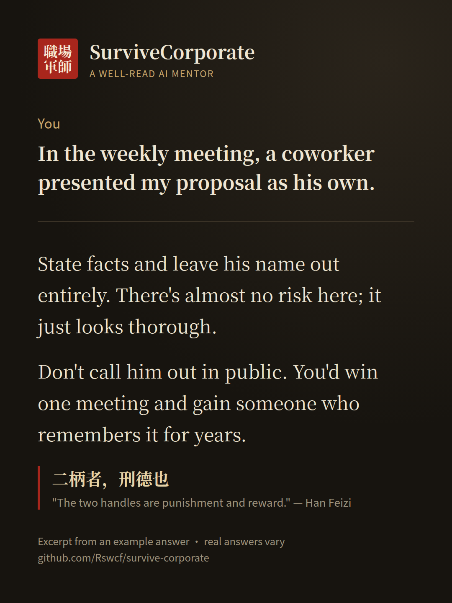

<div align="center">

# SurviveCorporate

**Two thousand years of statecraft, packed into your AI assistant.**

A coworker takes credit for your work. You get blamed for a slipped deadline. Your projects quietly move to someone else. Ask a generic AI and you mostly hear "communicate openly and stay positive."  
With SurviveCorporate, your AI talks like a seasoned mentor who has read Han Feizi and Machiavelli: it helps you see what is really going on and calmly walks you through **firm, legal** ways to handle office politics, including where each move could backfire.

A free, open-source Agent Skill for Claude Code, Claude.ai and Cursor. Ask in English or Chinese.

[](#install)
[](./LICENSE)

[中文](./README.md) · **English**


</div>

## Try it in one minute

In Claude Code, type:

```text
/plugin marketplace add Rswcf/survive-corporate
/plugin install survivecorporate@survive-corporate
```

Then just describe what happened, for example "In the weekly meeting, a coworker presented my proposal as his own." Using Claude.ai or Cursor? See [Install](#install).

---

## Demo

**You**: In the weekly meeting, coworker A presented my proposal as his own.

**SurviveCorporate** (excerpt from the English example in [`examples.md`](./skills/survivecorporate/references/examples.md); real answers vary by model and context):

> I've seen this one many times. Before you say anything in the team chat, take a breath.
>
> What he's really taking isn't just this proposal; it's the right to say whose work it was. Han Feizi opens his chapter "The Two Handles" with 二柄者，刑德也 — "the two handles are punishment and reward." Whoever controls how work gets judged is holding one of those handles. You're exposed right now not because you can't speak up, but because there's no written trail.
>
> The safest move is to create that trail today. Send a short follow-up to everyone who was in the meeting and to your manager: "Following up on the proposal we discussed — I've attached versions 1 through 3 and the numbers behind them. Happy to walk through the rollout next week." State facts and leave his name out entirely. There's almost no risk here; it just looks thorough.
>
> If he keeps presenting it, you can add calmly at the next meeting, "I ran those numbers — let me add two points." That's a little riskier because it's face to face; if your tone slips, it sounds like you're grabbing the mic. …
>
> Three things to do today: write down the timeline from the first draft to now, send that follow-up email, and ask a colleague from another team who has seen your work to attend the next review.
>
> One last thing: don't call him out in public. You'd win one meeting and gain someone who remembers it for years. Han Feizi understood the dangers of speaking up better than anyone, and he still died after his former classmate Li Si framed him.

No tables, no scores. It talks you through the situation the way a well-read senior colleague would over coffee: what's really going on, three ways forward, where each one can go wrong, and what to do today. Classical quotes stay in Chinese with an English translation.



More cards (quoted from the example answers) are in [`assets/cards/`](./assets/cards/).

---

## What it helps with

No commands to learn. Describe the situation the way you would to a mentor you trust. Some openers to copy:

- "A new director was parachuted in with two of his old reports, and my projects are slowly being taken away."
- "The project slipped and the PM told everyone they were waiting on me, but requirements were only signed off last week."
- "A senior report goes over my head to my boss and quietly ignores my instructions."
- "HR wants to meet about 'several complaints' and asked me to write a statement first."
- "My boss praised me in front of everyone, then handed me the project nobody wants. What's going on?"

You'll get sharper advice if you mention **your role and who you report to, who the other person is, what emails or records exist, and what outcome you want**. If something important is missing, it asks you a few questions first.

---

## How it differs from "dark wisdom" quote dumps

| | Quote collections | SurviveCorporate |
|---|---|---|
| Form | A pile of aphorisms | A well-read mentor who talks your situation through |
| Gives you | An attitude | Three ways forward, three things to do today, words you can use as-is |
| Risk | Not mentioned | Where each option can go wrong, how to guard against it, when to stop |
| Sources | Often misattributed | Key quotes checked against Wikisource and standard translations; uncertain ones are marked |
| Limits | None | Legal moves only; the darker texts are used to recognize and defend, never to attack |

---

## What's inside

- **68** workplace rules drawn from the classics, each with its source, how it plays out at work, and how risky it is
- 18 common office moves (credit theft, blame-shifting, being kicked upstairs, coordinated complaints…) and the first thing to do when you spot one
- 6 worked examples: credit theft, being sidelined, blame-shifting, coordinated complaints, a parachuted boss, an insubordinate report, plus an English example
- How it ended for Shang Yang, Han Feizi, Li Si, Lai Junchen and others: the ways each tactic came back to bite the people who used it

---

## Install

### Claude Code (recommended)

```text
/plugin marketplace add Rswcf/survive-corporate
/plugin install survivecorporate@survive-corporate
```

Or copy it in by hand:

```bash
git clone https://github.com/Rswcf/survive-corporate.git
mkdir -p ~/.claude/skills
cp -r survive-corporate/skills/survivecorporate ~/.claude/skills/
```

Start a new session and describe your situation.

### Claude.ai

1. Download `survivecorporate.zip` from [Releases](https://github.com/Rswcf/survive-corporate/releases). If there is no release yet, build it yourself:

   ```bash
   git clone https://github.com/Rswcf/survive-corporate.git
   cd survive-corporate/skills && zip -r ../survivecorporate.zip survivecorporate
   ```

2. Turn on **Settings → Capabilities → Code execution and file creation**.
3. Go to **Customize → Skills**, click **+** → *Create skill* → *Upload a skill*, and upload the zip.
4. In a new chat: "A coworker took credit for my work — help me think it through with SurviveCorporate."

### Cursor

```bash
git clone https://github.com/Rswcf/survive-corporate.git
mkdir -p ~/.cursor/skills
cp -r survive-corporate/skills/survivecorporate ~/.cursor/skills/
```

If you already installed it for Claude Code, you're done: Cursor also reads `~/.claude/skills/`. Type `/survivecorporate` in Agent to call it.

### Other Agent Skills–compatible tools

Copy the whole `skills/survivecorporate/` folder, including `references/`, into the tool's skills directory (for example `~/.agents/skills/`).

---

## Hard limits

It won't help with fabricated evidence, false accusations, harassment or intimidation, snooping on accounts or private lives, discrimination, or retaliation against whistleblowers. If you ask, it offers an equally effective legal move instead: a written record, telling your side first, building allies, asking your manager to decide, or going through HR or legal channels.

For harassment, discrimination, unpaid wages or workplace injury, it reminds you to keep evidence and talk to a labor authority or a lawyer.

The historical frame-up techniques are there only to help you recognize when someone is using them on you.

---

## Sources

- **China**: *Han Feizi*, *The Book of Lord Shang*, *Six Secret Teachings*, *Guiguzi*, *Records of the Grand Historian*, *Zizhi Tongjian*, and Tang-dynasty records of Lai Junchen's frame-ups
- **India**: the *Arthashastra* on reading people and testing loyalty
- **Europe**: core chapters of Machiavelli's *The Prince*, and medieval interrogation manuals (only to recognize leading questions)

Known forgeries and misattributed texts are labeled. Verification notes: [`sources.md`](./skills/survivecorporate/references/sources.md). Research notes (in Chinese): [`research/`](./research/).

---

## Contributing

New rules (with verifiable original text), anonymized workplace cases, citation fixes and translations are welcome. See [CONTRIBUTING.md](./CONTRIBUTING.md) or open an [issue](https://github.com/Rswcf/survive-corporate/issues/new/choose).

Anonymize scenarios completely: no real names, companies or teams. Issues are public.

---

## Author

Made by Yijie Ma ([@Rswcf](https://github.com/Rswcf)). Follow me on GitHub for new skills and updates.

## Disclaimer

Historical and strategic research plus an AI skill; not legal or HR advice. It only suggests lawful responses. Follow your local law and company policy. The darker techniques from the classics are for recognition and defense, not for harming anyone.

## License

[MIT](./LICENSE). Please cite classical sources when you quote them.
