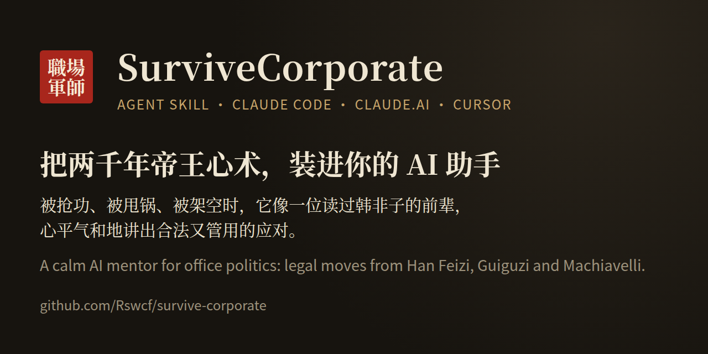
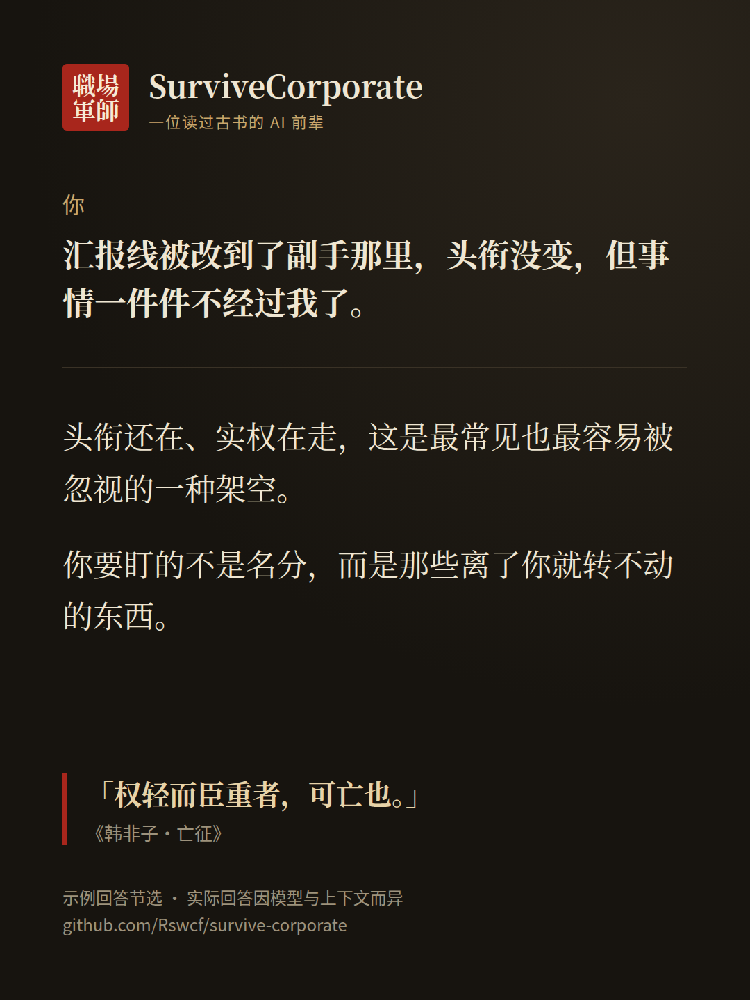
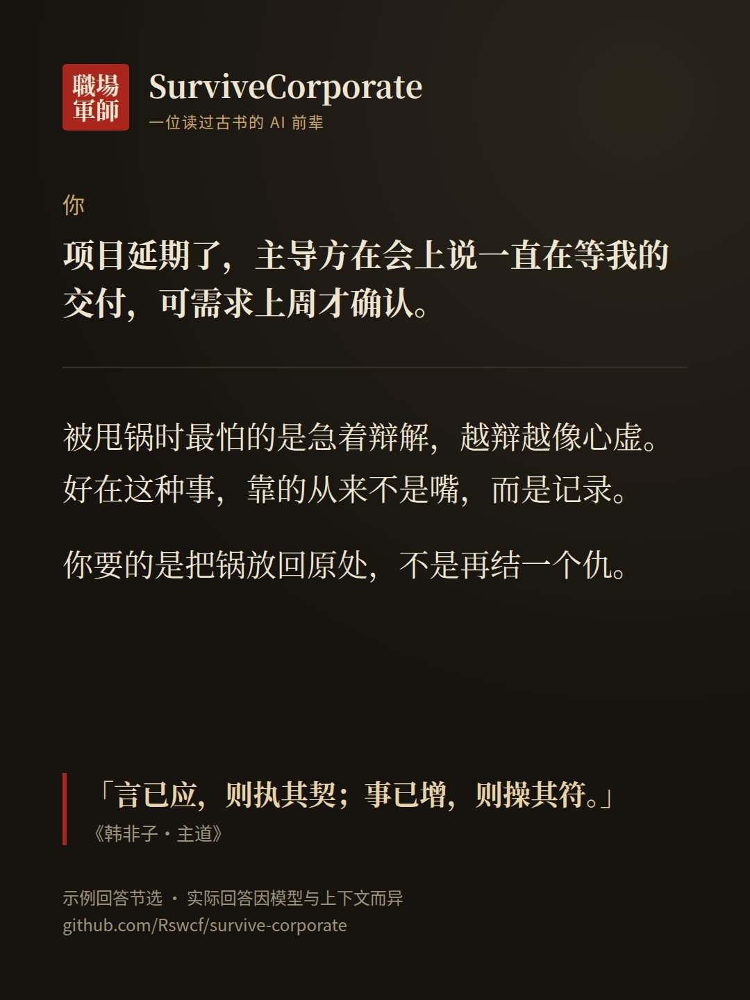
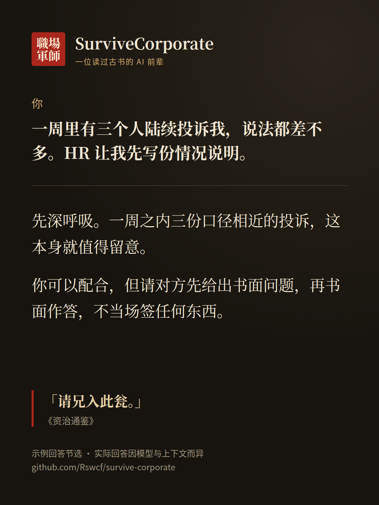

<div align="center">

# SurviveCorporate · 职场军师

**把两千年帝王心术，装进你的 AI 助手。**

被抢功、被甩锅、被架空、被集体投诉时，问普通 AI，多半只能听到「多沟通、保持积极」。  
装上它，你的 AI 会像一位读过《韩非子》的老前辈，心平气和地帮你看清局面，讲出**合法又管用**的应对，连每一步险在哪里都提前告诉你。

一个开源、免费的 AI Agent Skill，适用于 Claude Code、Claude.ai 和 Cursor。中英文都可以问。

[](#安装)
[](./LICENSE)

**中文** · [English](./README.en.md)



</div>

## 一分钟上手

在 Claude Code 里输入这两行：

```text
/plugin marketplace add Rswcf/survive-corporate
/plugin install survivecorporate@survive-corporate
```

然后直接说你遇到的事，比如「周会上同事把我的方案当成他的成果汇报了」。用 Claude.ai 或 Cursor？看下面的[安装](#安装)。

---

## 效果展示

**你**：周会上同事 A 把我做的方案当成他的成果汇报了。

**SurviveCorporate**（示例回答节选，出自 [`examples.md`](./skills/survivecorporate/references/examples.md) 例 1；实际回答因模型与上下文而异）：

> 这种事我见得不少，先别急着在群里发火。
>
> A 抢的其实不只是这一份方案，而是“这份功劳算谁的”这个说法权。《韩非子·二柄》开篇就说“二柄者，刑德也”——管人的两把刀柄，一把是罚，一把是赏，谁握着评价权，谁就握住了其中一把。你现在吃亏，不是不会说话，而是手里没有书面痕迹。
>
> 所以最稳的一步，是今天之内把痕迹补上。给参会的人和你的直属领导发一封会后跟进邮件：“会上提到的方案，我把 V1 到 V3 和测算数据整理在附件里，下周我来讲落地节奏。”只摆事实，一个字都别提 A。这一步几乎没什么风险，谁看了都只会觉得你做事周全。
>
> 如果下次开会他还接着讲，你可以平静地补一句：“数据是我跑的，我补充两点。”这比邮件险一些，险在当面——语气一冲，就从补充变成了抢话。……
>
> 今天先做三件事：一是把方案的时间线理清楚；二是把那封跟进邮件发出去；三是约一位看过你工作的跨部门同事，下周评审时到场。
>
> 最后提醒一句：千万别当众揭穿他。你赢了一场会，却会多一个记你很多年的人。韩非把进言的凶险写得那么透，最后还是死在同学李斯的构陷里——看得清局，不等于能全身而退。

没有表格，没有打分，就像一位前辈坐下来跟你喝杯茶：先把局面说破，再讲三条路、每条路险在哪，最后告诉你今天先做什么。

<!-- 录好真实使用的 GIF 或截图后放在这里，例如： -->

<table>
<tr>
<td></td>
<td></td>
<td></td>
</tr>
</table>

更多分享卡片在 [`assets/cards/`](./assets/cards/)，内容均摘自示例回答，可以直接转发。

---

## 它能帮你应对什么

不用记命令，像跟一位信得过的前辈聊天那样，把事情讲出来就行。可以直接复制这些开头：

- 「新领导空降，带了两个旧部，我原来的项目被慢慢收走了，怎么办？」
- 「项目延期，PM 在会上说一直在等我的交付，但需求是上周才确认的。」
- 「资深下属绕过我直接找大老板，我安排的事他也软抵制。」
- 「HR 约我谈话，说收到几份对我的投诉，让我先写份情况说明。」
- 「老板当众夸我，然后让我接一个没人要的烂项目。这是什么套路？」

讲清楚**你的位置和汇报关系、对方是谁、手里有哪些邮件或记录、你想要什么结果**，它给的建议会更贴身。信息不够时，它会先问你几个问题。

---

## 和「厚黑语录」有什么不同

| | 语录、鸡汤 | SurviveCorporate |
|---|---|---|
| 形态 | 一堆金句 | 一位懂古书的前辈，把你的事从头讲透 |
| 给你什么 | 一种态度 | 三条路、今天就能做的三件事、可以直接用的原话 |
| 风险 | 不提 | 每条路险在哪、怎么防、什么时候该收手 |
| 出处 | 常有张冠李戴 | 关键原文对照维基文库和通行译本核对，拿不准的会注明 |
| 底线 | 没有 | 只给合法的办法；古书里的阴招只用来识破和防身 |

---

## 内容一览

- **68** 条从古书里提炼的职场法则，每条都写明出处、在职场里怎么用、风险有多大
- 18 种常见的职场招数（抢功、甩锅、捧杀、架空、集体投诉……），以及识破后的第一步
- 6 个完整示例：抢功、架空、甩锅、集体投诉、空降领导、下属不服，另有英文示例
- 商鞅、韩非、李斯、来俊臣等人的下场：每一招在历史上是怎么反过来伤到自己的

---

## 安装

### Claude Code（推荐）

```text
/plugin marketplace add Rswcf/survive-corporate
/plugin install survivecorporate@survive-corporate
```

不想用插件市场，也可以手动复制：

```bash
git clone https://github.com/Rswcf/survive-corporate.git
mkdir -p ~/.claude/skills
cp -r survive-corporate/skills/survivecorporate ~/.claude/skills/
```

新开一个会话，直接描述你的情况即可。

### Claude.ai

1. 从 [Releases](https://github.com/Rswcf/survive-corporate/releases) 下载 `survivecorporate.zip`。还没有发布版本时，可以自己打包：

   ```bash
   git clone https://github.com/Rswcf/survive-corporate.git
   cd survive-corporate/skills && zip -r ../survivecorporate.zip survivecorporate
   ```

2. 在 **Settings → Capabilities** 中打开 *Code execution and file creation*。
3. 打开 **Customize → Skills**，点 **+** → *Create skill* → *Upload a skill*，上传这个 zip。
4. 新对话里说：「同事抢功，用 SurviveCorporate 帮我分析」。

### Cursor

```bash
git clone https://github.com/Rswcf/survive-corporate.git
mkdir -p ~/.cursor/skills
cp -r survive-corporate/skills/survivecorporate ~/.cursor/skills/
```

已经按 Claude Code 方式装过的不用重复，Cursor 也会读取 `~/.claude/skills/`。装好后在 Agent 里输入 `/survivecorporate` 即可调用。

### 其他支持 Agent Skills 的工具

把整个 `skills/survivecorporate/` 文件夹放进该工具的 skills 目录（例如 `~/.agents/skills/`）。注意要连同里面的 `references/` 一起复制。

---

## 红线

它不会教你伪造证据、诬告、骚扰恐吓、偷看别人账户或隐私、歧视，也不会帮你报复举报人。你提出这类想法时，它会换成效果相当、但不会反咬自己的合法做法：留下书面记录、先把事情讲清楚、找到同盟、请上级拍板、走 HR 或法律途径。

遇到性骚扰、歧视、欠薪、工伤这类事，它会提醒你保存证据，并咨询当地劳动监察部门或律师。

古书里那些整人的手段，只用来帮你识破别人对你的算计。

---

## 典籍出处

- **中国**：《韩非子》《商君书》《六韬》《鬼谷子》《史记》《资治通鉴》，以及唐代史书中关于来俊臣「罗织」构陷的记载
- **印度**：《政事论》（Arthashastra）中关于识人与测试忠诚的部分
- **欧洲**：马基雅维利《君主论》的核心章节，以及中世纪审讯手册（只用于识破诱导式提问）

常见的伪书和托名之作都已单独标明，核实说明见 [`sources.md`](./skills/survivecorporate/references/sources.md)，研究笔记见 [`research/`](./research/)。

---

## 参与贡献

欢迎补充新法则（请附可核对的原文）、匿名的职场案例、引文勘误和译文。见 [CONTRIBUTING.md](./CONTRIBUTING.md)，或先用 [Issue 模板](https://github.com/Rswcf/survive-corporate/issues/new/choose) 聊聊。

提交职场案例时请彻底匿名：不写真实姓名、公司和部门，Issue 是公开的。

---

## 作者

由 Yijie Ma（[@Rswcf](https://github.com/Rswcf)）制作。欢迎在 GitHub 上关注我，后续的新 skill 和更新都会发在这里。

如果它帮你少踩了一个坑，点个 Star，或者把上面的卡片转给正被同事抢功的朋友。

---

## 免责声明

本仓库是历史与策略研究，以及一个 AI skill，不构成法律或人力资源方面的专业意见。它只给出合法的应对方式。请遵守所在地法律和公司规定；古书中的阴暗手段只用于识别和防范，不用于伤害他人。

## License

[MIT](./LICENSE)。引用古籍原文时请注明出处。
